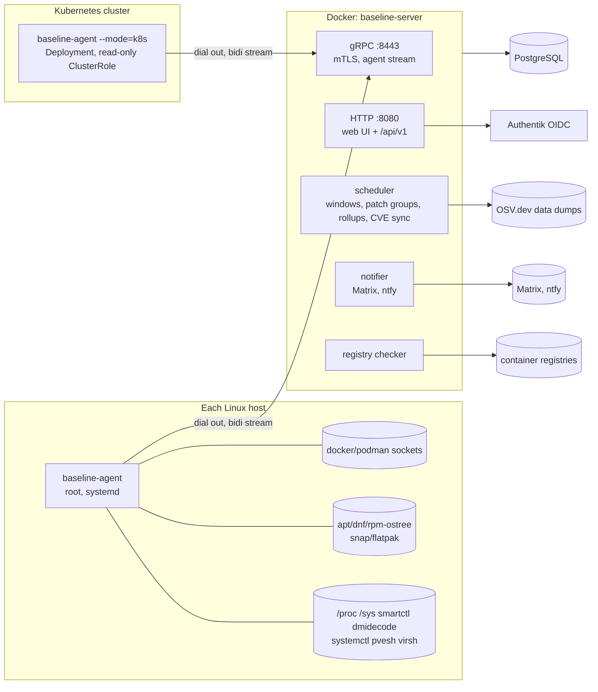

# Architecture

## 1. Goals and constraints

- **Scope: infrastructure and the work around it.** Baseline started as a CMDB with change management and orchestration. It now also tracks work: incidents, requests, problems and project work (stories, tasks, bugs) live in the same server and database as the CIs and changes they concern, and link to them directly (data-model.md §8). Ticketing is part of the core, not an optional module, so every install has it.

- **Scale:** tens of Linux hosts in a homelab, one tenant. This is the design point, so we don't build for horizontal scale. Run one server instance.
- **Buildable in 10 years.** Prefer the standard library. Keep dependencies few and stable, commit them with `go mod vendor`, and commit generated code. No Node or npm toolchain. Front-end libraries are vendored as single files.
- **Use `github.com/jw6ventures/jw6-go-utils`** for logging (`Utils.Log`), Postgres management and migrations (`database.Manager`), and OIDC login (`oidc.Authenticator` + `oidc.CookieCodec`).
- **Every action is audited.** Anything that changes a host goes through change management (see [change-management.md](change-management.md)).
- **Linux only** for now. Agent collectors are behind interfaces so other OSes can be added later.

## 2. Components



### 2.1 baseline-server (one binary in one Docker image)
- **HTTP listener (`:8080`).** Serves the web UI as server-rendered `html/template` pages and the JSON REST API at `/api/v1` ([api.md](api.md)): reads of everything the UI shows, under the same role checks, plus creating, submitting, cancelling and closing changes, manual CI relationships, and filing and working on work items. It sits behind Traefik, which terminates TLS for it (§7).
- **gRPC listener (`:8443`).** Agents connect here. It terminates its own TLS with the Baseline internal CA, so Traefik must **not** terminate it. Traefik routes it with a TCP router in TLS passthrough mode, matched on SNI (§7).
- **Background workers** run in the same process:
  - scheduler (cron-style, timezone aware)
  - metric rollup and partition maintenance
  - registry digest and tag checks
  - CVE database sync and matching
  - alert evaluation
  - notification delivery
  - agent-release publishing
- **Migrations and the base schema** ship in the image under `/app/db/`. `database.Manager` reads them from a filesystem path (`MigrationsPath`, `SchemaPath`). `AppVersion` is the binary's version.

### 2.2 baseline-agent (one static binary, `CGO_ENABLED=0`)
- **Host mode (default).** Runs as root under systemd. It collects inventory, metrics and hardware, and executes typed actions and scripts.
- **k8s mode (`--mode=k8s`).** Runs in a cluster as a Deployment with a service account and a read-only ClusterRole, configured from the environment, and enrolls itself on first start (agent.md §6). It reports cluster-level objects: nodes, workloads, services and ingresses. It reports the capability `k8s-cluster` instead of a host's, runs no jobs and is updated by changing its image. A host-mode agent on each node still reports that node's OS, packages and containers, and its runtime's pods.
- **Config:** `/etc/baseline/agent.conf`, a simple `key = value` format parsed with the stdlib to avoid a YAML dependency. It also holds a **local policy**: the host owner can turn off scripts or specific actions no matter what the server asks (§5.3).

## 3. Agent ↔ server protocol

**Transport:** gRPC over TLS 1.3 with mutual authentication. **The agent always dials out**, so hosts never need inbound ports. The definition is `api/agent/v1/agent.proto`; `make proto` regenerates the committed Go code.

```proto
service AgentGateway {
  rpc Enroll(EnrollRequest) returns (EnrollResponse);           // server-auth TLS only
  rpc Connect(stream AgentMessage) returns (stream ServerMessage); // mTLS
  rpc DownloadRelease(ReleaseRequest) returns (stream Chunk);   // mTLS, self-update (M2)
}
```

**Agent → server (`AgentMessage` oneof):**
| Message | When |
|---|---|
| `Hello` | Sent first on connect. Carries agent version and architecture (GOARCH, for self-update), host identity (machine-id, DMI product UUID, hostname), boot ID, capabilities detected (docker, podman, apt, smartctl, pvesh…), the content hash of each inventory section the agent last collected, and its local policy (M4). |
| `InventorySection` | A full snapshot of one section: os, hardware, packages, updates, smart, containers (with Compose stacks), vms, k8s_node, services, ports, reboot, certs, or a cluster agent's k8s. The payload is the section's JSON (types in `internal/model`, shared by agent and server) with its SHA-256 and a schema version. Sent only when the section's content hash changes, or when the server asks. The server diffs it against the stored copy and writes change history. |
| `MetricBatch` | Every 60s for host metrics and every 90s for container metrics. Carries when the readings were taken and when the batch was sent, both by the agent's clock; the server shifts the timestamps by the difference between "sent" and its own clock when they disagree by more than 2s. |
| `IntegrationResult` | Answers an `IntegrationPoll`: what the agent read (JSON), or why it couldn't. |
| `LogChunk` | Lines of a container log a `StartLogs` asked for, numbered, with how many were dropped; the last one is marked done, with the error if the log couldn't be read (agent.md §3.5). |
| `UpdateResult` | A self-update failed: bad download or signature, or a new version that was rolled back. Success shows as the new version in the next `Hello`. |
| `JobEvent` | Command accepted/started, output chunk (stdout/stderr), progress, result (exit code, structured result). |
| `Heartbeat` | Every 30s when nothing else has been sent. |
| `CertRenewRequest` | Sent once the client cert has passed two-thirds of its lifetime. |

**Server → agent (`ServerMessage` oneof):**
| Message | Purpose |
|---|---|
| `Config` | Collection intervals, cert scan paths, toggles. Pushed on connect and whenever it changes. |
| `RequestInventory` | Force a resend of a section, e.g. "refresh now" in the UI. |
| `RunJob` | `job_id`, typed action + parameters, or a script (body, interpreter, sha256, args), deadline, and the change ID it belongs to. |
| `CancelJob` | Best-effort cancellation. |
| `CertRenewResponse` | A new client cert. |
| `IntegrationPoll` | Read a system on the host's network for the server, such as a UniFi console: kind, settings, the API key (held for the poll only) and a timeout. Sent only to agents reporting the integration's capability (integrations.md). |
| `StartLogs` / `StopLogs` | Read a container's log: engine, container, tail lines, follow and a time limit; `StopLogs` ends a followed read. Sent only to agents reporting `container-logs`. The server passes the lines on to the viewer and stores none (agent.md §3.5). |
| `UpdateAgent` | Target version, arch, size, sha256 and the ed25519 signatures made in CI. The agent pulls it with `DownloadRelease` (agent.md §5.2). |

**Rules:**
- Sending full snapshots per section, with hash-based suppression, keeps things simple. At tens of hosts the bandwidth is trivial and it rules out bugs where deltas drift.
- If the server is unreachable, the agent buffers metrics in an in-memory ring of about 6 hours and flushes it on reconnect. Inventory is just resent. A resent metric batch is a no-op (`metric_raw` is keyed by series and time).
- Job IDs are idempotency keys. If the agent receives a `job_id` it has already run, it replies with the stored result and doesn't run it again. The server sends every job it dispatched but has no result for again whenever the agent connects, so a `RunJob` lost with a dropped stream still runs once.
- The agent reconnects with exponential backoff and jitter (1s → 60s).

## 4. Enrollment, identity and certificates

1. On first start, the server creates an **internal CA** (ECDSA P-256), a server cert for `:8443`, and an ed25519 key that signs agent releases only for agents older than CI signing (agent.md §5.2). All are stored in a data volume (`/data/pki`) rather than the DB. Current agent releases are signed in CI with a key the server never has.
2. An admin creates an **enrollment token** in the UI (Settings → Enrollment). It has a name, an optional use limit, an expiry, and host groups that new hosts join. The token is `baseline1.<secret>.<CA fingerprint>`, both parts base64url: the fingerprint lets a new agent pin the CA without being given a file, and only the secret's SHA-256 is stored. The UI shows the token once.
3. Install with: `curl -fsSL https://baseline.example/install.sh | sudo sh -s -- --token …` The server renders the script with its own web and gateway addresses baked in. The script downloads the binary for the host's architecture from `/download/` (the server image carries amd64 and arm64 builds), checks it against `/download/SHA256SUMS`, installs it and the systemd unit, runs `baseline-agent enroll`, and starts the agent. Running it again upgrades the binary and keeps the identity. There are no .deb or .rpm packages: the binary, install script and unit are the whole distribution, and self-update keeps agents current after that. The binary goes in `/usr/local/libexec/baseline/` (symlinked from `/usr/local/bin`). That path is writable on every target distro, including image-based Bazzite, where `/usr` is read-only, and SELinux labels it `bin_t`, which systemd may execute.
4. The agent generates its own private key, which never leaves the host, and sends a CSR with the token to `Enroll`. The server validates the token and creates the host record. It issues a **90-day client cert** whose common name is the agent ID. Every enrollment creates a new host: an existing host is never re-bound, because machine-id and DMI UUID are reported by the agent itself (machine-id is world-readable) and matching on them would let any token holder take over another host's record. A machine whose agent state was wiped appears next to its old, offline record, which an admin revokes. Tokens default to a single use in the UI, and `install.sh` passes the token through the environment so it doesn't show in `ps`.
5. Renewal happens automatically over the authenticated stream once the cert is two-thirds through its life, at most once per stream. The serial the agent is connected with stays valid until it first connects with the new one, so lost renewal responses, even several in a row, can't lock an agent out. Revocation is re-checked under a row lock when a stream registers and when it renews. To revoke, flag the host as revoked (host Settings tab, admin). The server checks the cert serial against the DB on every connect, so no CRL is needed because the server is the only verifier.
6. **Clone detection:** if two hosts report the same machine-id or DMI UUID, both are flagged. This catches VM clones and templates. A clone that also copied the agent's state (same cert) is caught on connect: while one stream is live, a stream for the same agent from a different boot ID is refused and the host flagged, rather than letting the two knock each other off. A reconnect from the same boot replaces the old stream.

## 5. Security model

### 5.1 Web authentication
- OIDC with Authentik via `jw6-go-utils/oidc`, using Authorization Code + PKCE.
- **Sessions are stored server-side.** `oidc.Session` holds the ID, access and refresh tokens plus all claims, which together can pass the ~4 KB browser cookie limit. We store the session in Postgres. The cookie only holds a random session ID, sealed with `CookieCodec`.
- Session lifetime is 12h, sliding, with a 7-day absolute cap. `SameSite=Lax`, `Secure`, `HttpOnly`. The user's IdP groups are stored with the session; grants are resolved from them and the current bindings on every request, so binding changes apply without signing out.
- CSRF protection comes from Go's stdlib `http.CrossOriginProtection` on all non-GET routes.
- **API tokens** let scripts call `/api/v1` ([api.md](api.md)). A token is tied to a user and to a subset of that user's roles, carries the IdP groups of the session that made it, and is checked against the current bindings on every request. Only its hash is stored; the UI shows the secret once. Tokens are made and revoked on the user's own "Your access" page.

### 5.2 Authorization (RBAC)
- **Roles:** `viewer`, `operator` (includes viewer), `approver` (includes viewer), and `admin` (includes viewer, operator and approver, plus settings, users, enrollment, the script library and role bindings).
- **Scope:** a role binding is either `global` or scoped to a host group. A user can be an operator for `media` and only a viewer everywhere else. Admin is always global.
- **Bindings** map Authentik groups to `(role, scope)`. They're edited in the UI and re-evaluated at every login from the `groups` claim. Authentik's default profile scope mapping emits `groups`.
- A bootstrap admin is set with the env var `BASELINE_BOOTSTRAP_ADMIN_GROUP` so the first login can configure everything.
- **Work items** don't touch hosts, so anyone with a role (any scope) can open, edit, comment on and watch them. Admins set up projects and ticket types. A CI or change linked to an item shows only to people who may see that CI or change, and the item's history hides entries about them too.

### 5.3 Remote execution safety
The server can run commands as root on every host, so the server *is* the crown jewel. Mitigations:
- **Typed actions are the default.** Free-form shell isn't an option in the UI. Scripts only come from the **script library**. Creating or editing a library script needs admin. Every version of a script is immutable and identified by its sha256.
- Everything that runs on a host runs as part of a **change record** (see change-management.md) and is audited.
- **Agent-local policy** in `agent.conf` can turn off categories: `allow_scripts = false`, `allow_actions = patch,compose,reboot`, and `self_update = off` stops the server replacing the agent binary. The server can't override it. The agent reports its policy in `Hello` so the UI can grey out blocked actions.
- **Self-update binaries are verified** against ed25519 release keys built into the agent. They're signed in CI (`.github/workflows/release.yml`, `RELEASE_SIGNING_KEY` secret) and the server only passes the signatures on, so a compromised server can hand out old releases but can't make a new binary that ignores the local policy (agent.md §5.2).
- Registry credentials and notification tokens are encrypted at rest with a key from `BASELINE_SECRET_KEY` (AES-GCM).

### 5.4 Audit
There's one append-only `audit_log` table, written for:
- every login and logout
- every API or UI mutation
- every job dispatch and result
- every change-state transition
- every enrollment and revocation

Each row stores the SHA-256 of the previous row's hash plus its own content (a hash chain), so verification detects altered, removed or reordered rows. Appends are serialized with an advisory lock so the chain has one head. A trigger rejects `UPDATE`, `DELETE` and `TRUNCATE` for every role, including the owner. Admins can verify the chain from the audit page; a nightly verification job arrives with the scheduler.

## 6. Web UI

- Pages are rendered on the server with `html/template` and `go:embed`. There's no front-end build step.
- **JS is progressive enhancement and vendored** under `web/static/vendor/`, with each file's version and SHA-256 recorded in `THIRD_PARTY.md`:
  - **htmx** (single file, no deps) for partial updates such as tables, filters and approval buttons. The list engine ([lists.md](lists.md)) swaps lists in place with it.
  - **uPlot** (single file, no deps) for interactive time-series charts.
- Sparklines and small charts are **server-rendered SVG** from Go, with no JS.
- Live job output streams with Server-Sent Events through a few lines of vanilla `EventSource` code.
- The dashboard and host pages refresh their status in place: `static/live.js` refetches the page every 30 seconds while the tab is visible and swaps the regions marked `data-live`, skipping one the user is focused or selecting in. Polls send `X-Baseline-Live: 1`, so they don't extend the session's idle timeout, and a signed-out poll gets a 401 instead of the sign-in redirect.
- The CSS is hand-written with custom properties and supports light and dark themes. There's no CSS framework.
- Every page works without JS, apart from interactive zoom and live tailing.

**Main screens:**
- Dashboard: fleet health, pending updates, CVEs, failing SMART, expiring certs, upcoming windows, changes awaiting approval
- Work items, with a work item page: details, status, linked CIs, changes and items, child items, comments and work notes, watchers, history
- Projects, each offering a set of shared ticket types
- Hosts, with a host detail page
- Containers & Compose stacks
- Updates
- Vulnerabilities
- Changes
- Calendar of maintenance windows and scheduled changes
- Patch groups
- Script library
- Jobs
- CIs (all types, including agentless) and their relationship graph
- Alerts
- Audit log
- Settings: role bindings, enrollment tokens, ticket types, registries, notification channels, agent releases

## 7. Deployment

**Host rule: nothing binds to a public address.** The compose file therefore publishes **no ports by default**. Both listeners are reached through Traefik over a shared Docker network.

| Listener | Traefik routing |
|---|---|
| `:8080` HTTP | HTTP router `Host(baseline.example)`. Traefik terminates TLS. |
| `:8443` gRPC | TCP router `HostSNI(agent.baseline.example)` with `tls.passthrough=true` on the existing TLS entrypoint. Baseline terminates TLS and checks the client cert. Using a separate SNI name keeps the web hostname free for a normal HTTP router. |

If passthrough on the shared entrypoint is undesirable, the fallback is to publish 8443 **on the VPN host IP only** (`${BASELINE_VPN_IP}:8443:8443`). It's in the compose file, commented out. `BASELINE_GRPC_PUBLIC_ADDR` is the address agents dial in either case.

`deploy/compose.yaml`:
- `baseline-server`: no published ports, with Traefik labels for both routers. Volume `/data` holds PKI (`/data/pki`) and agent releases with their CI signatures (`/data/releases/<version>/`). Configured with env vars (see `deploy/.env.example`):
  - Every variable below also reads its `JCMDB_` name, from before the rename (decision 26).
  - `BASELINE_DB_URL` (set by the compose file), `BASELINE_DB_SCHEMA`, `BASELINE_DB_MIGRATIONS`
  - `BASELINE_OIDC_ISSUER`, `BASELINE_OIDC_CLIENT_ID`, `BASELINE_OIDC_CLIENT_SECRET`, `BASELINE_OIDC_REDIRECT_URL` (defaults to `<public URL>/auth/callback`), `BASELINE_OIDC_GROUPS_CLAIM` (defaults to `groups`)
  - `BASELINE_BOOTSTRAP_ADMIN_GROUP`
  - `BASELINE_COOKIE_KEY`, `BASELINE_SECRET_KEY` (base64, 32 bytes each)
  - `BASELINE_PUBLIC_URL`, `BASELINE_HTTP_ADDR`
  - `BASELINE_GRPC_ADDR` (default `:8443`), `BASELINE_GRPC_PUBLIC_ADDR` (`host:port` agents dial; compose builds it from `BASELINE_AGENT_HOST`/`BASELINE_AGENT_PORT`), `BASELINE_GRPC_EXTRA_NAMES` (more names for the gateway cert)
  - `BASELINE_DATA_DIR` (`/data`), `BASELINE_AGENT_DIR` (agent binaries, `/app/agent` in the image)
  - `BASELINE_LOG_LEVEL`, `BASELINE_TZ`
  - `BASELINE_OSV_URL` (M6): where OSV data comes from; empty for OSV's bucket, a mirror's URL, or `off`. The server needs outbound HTTPS to it, and to Matrix and ntfy servers for notifications.
- `postgres`: a dedicated container in the same compose file on an internal-only network, with no published ports and a named volume. Pinned major version, plain Postgres. **No TimescaleDB.** Native declarative partitioning is enough at this scale and keeps the stack standard (see data-model.md §5).

The Docker host should also run a host-mode agent, so the server's own host is monitored too.

## 8. Repository layout

```
github.com/jw6ventures/baseline      (single Go module, AGPL-3.0, © James Williams)
├── cmd/baseline-server/           main
├── cmd/baseline-agent/            main
├── cmd/baseline-sign/             signs agent releases in CI
├── api/agent/v1/               .proto + generated .pb.go (committed)
├── internal/
│   ├── config/                 env settings
│   ├── rbac/                   roles, bindings → grants
│   ├── server/                 http: auth, handlers, install.sh, downloads
│   ├── gateway/                agent gRPC service and hub of connected agents
│   ├── model/                  inventory section types shared by agent and server
│   ├── store/                  Postgres queries (database/sql + lib/pq, no ORM); storetest/ for tests
│   ├── inventory/              section diffs → change history
│   ├── action/                 typed actions shared by server and agent: params, policy categories, risk
│   ├── jobs/                   dispatches approved changes' jobs to agents, records results, live-output notifications
│   ├── change/                 change lifecycle, windows, patch groups (M5)
│   ├── scheduler/              cron parser + runner (in-house, ~300 LOC)
│   ├── vercmp/                 dpkg and rpm version comparators (agent and server)
│   ├── vuln/                   OSV sync and matching (M6)
│   ├── alert/                  alert rule kinds and evaluation (M6)
│   ├── registry/               OCI distribution client (stdlib), semver advisories
│   ├── checks/                 server-side checks: registry digests and tags, TLS endpoints, missing CIs
│   ├── notify/                 Matrix and ntfy delivery from the outbox (M6)
│   ├── pki/                    CA, enrollment, release keys and signatures
│   └── agent/
│       ├── collect/            collectors (see agent.md), package managers' read side
│       ├── runner/             job execution: actions, scripts, journal, outbox; package upgrades
│       └── container/          docker/podman Engine API client (stdlib, unix socket)
├── web/templates/ web/static/  embedded UI
├── db/db.sql db/migrations/    jw6 migration manager inputs (vX.Y.Z.sql)
├── web/install.sh.tmpl         installer (writes the systemd unit)
├── deploy/                     compose.yaml, .env.example
├── scripts/e2e.sh              server image + real agents on several distros
├── docs/
└── vendor/                     committed
```

## 9. Dependency policy

| Need | Choice | Why |
|---|---|---|
| Logging, DB manager, OIDC | `jw6-go-utils` (brings `lib/pq`, `go-oidc`, `x/oauth2`, `semver`) | Required |
| Semver parsing | `Masterminds/semver/v3`, already a dependency of `jw6-go-utils`, used directly for image tag advisories | No new module |
| RPC | `google.golang.org/grpc`, `google.golang.org/protobuf` | Agreed in Q&A. Stable, and generated code is committed. |
| Docker/Podman | **In-house** Engine API client over a unix socket | The official SDK pulls in a large dependency tree and churns often. We use about 15 endpoints. |
| Kubernetes | **In-house** read-only REST client with a service-account token | `client-go` is huge. We only need list/get. |
| Registries | **In-house** OCI distribution client | Only needs manifest HEAD/GET and tag listing |
| Cron, config, SVG charts | **In-house** | Each is small |
| Front end | htmx and uPlot, vendored single files (`THIRD_PARTY.md`) | No build toolchain |

Adding any new module needs a line in this table with a reason.

## 10. Decision log (from initial Q&A, 2026-10-10)

| # | Decision |
|---|---|
| 1 | Homelab scale (tens of hosts), one tenant |
| 2 | Agent dials out over a long-lived gRPC bidi stream with mTLS |
| 3 | Enrollment token → server-issued client cert → auto-rotation |
| 4 | One `baseline-server` binary, deployed in Docker, with Postgres |
| 5 | Linux only. Lab distros: **Ubuntu** (apt, snap), **Rocky Linux** (dnf), **Bazzite** (rpm-ostree/bootc image updates, flatpak). zypper, apk and pacman are deferred to "Later". |
| 6 | Agent runs as root. It uses `smartctl`, `dmidecode`, etc. when present and degrades gracefully without them. |
| 7 | Kubernetes: a per-node host agent **and** a cluster-mode collector |
| 8 | Proxmox (VMs + LXC) and libvirt/KVM are supported |
| 9 | Agentless CIs (manual entry) and CI relationships are supported |
| 10 | Image updates: same-tag digest drift always; newer semver tags as an opt-in rule per container |
| 11 | Compose auto-update is set per stack and **defaults to off** |
| 12 | ITIL-style change management, plus maintenance windows, with every action audited |
| 13 | Typed actions plus a saved-script library. No free-form shell. |
| 14 | Patch groups have their own schedules and can block one another |
| 15 | Authentik OIDC. Groups map to roles. Admin is a superset of viewer, operator and approver. |
| 16 | Host metrics every 60s and container metrics every 90s. 14 days raw plus 1 month of rollups. |
| 17 | Notifications go to Matrix and ntfy |
| 18 | v1 extras: CVE matching, reboot-required detection, systemd services, listening ports, TLS cert expiry, agent self-update |
| 19 | Go templates and minimal vendored JS. No jQuery, no npm. |
| 20 | One Go module at `github.com/jw6ventures/baseline`, copyright James Williams. (2026-10-30) Licensed under the AGPL-3.0; it was private before. |
| 21 | Traefik in front. No public binds: no published ports by default, gRPC via TCP passthrough on SNI, with the VPN IP only as a fallback. |
| 22 | Postgres runs as its own container in Baseline's compose file |
| 23 | Self-approval of changes is allowed and flagged in the audit log |
| 24 | Agent ships as a binary + install.sh + systemd unit. No .deb/.rpm. |
| 25 | (2026-10-24) Work tracking (Conduit: incidents, requests, problems, stories, tasks, bugs) extends Baseline itself: the same binary, schema and UI, with no fork, separate module or feature flag. The focus widens beyond the CMDB. |
| 26 | (2026-10-30) Renamed from jcmdb to Baseline, module `github.com/jw6ventures/baseline`. Upgrades stay drop-in: `BASELINE_` variables fall back to `JCMDB_`; agents keep `/etc/jcmdb` and `/var/lib/jcmdb` where they have them; the gateway also serves `jcmdb.agent.v1.AgentGateway`; old enrollment and API tokens are accepted; the release signature statement, the stack .env hash key's HKDF label and the audit lock key keep their jcmdb values, as running agents and stored data depend on them. |
